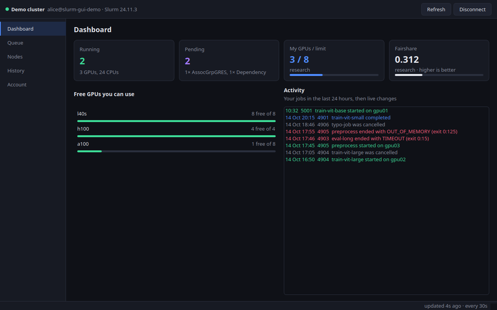
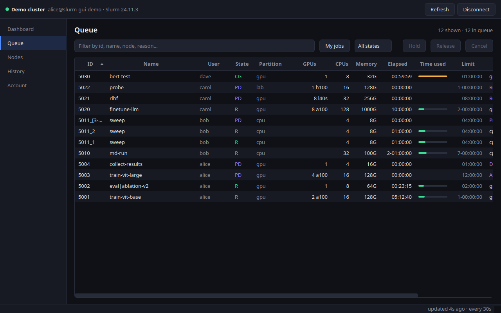
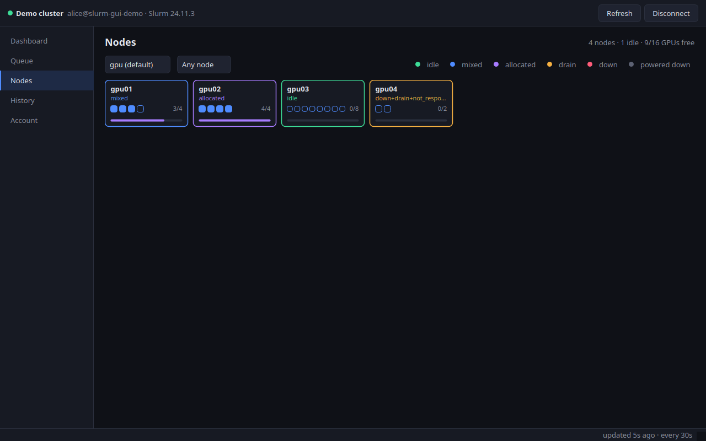
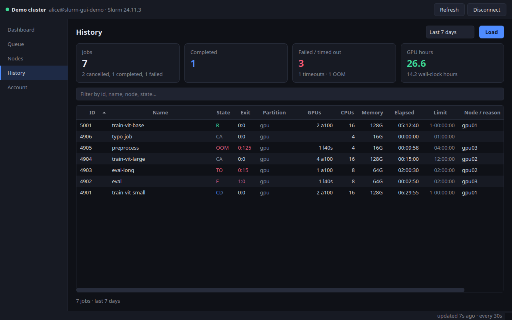
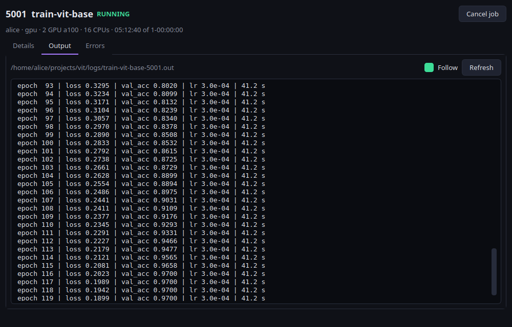
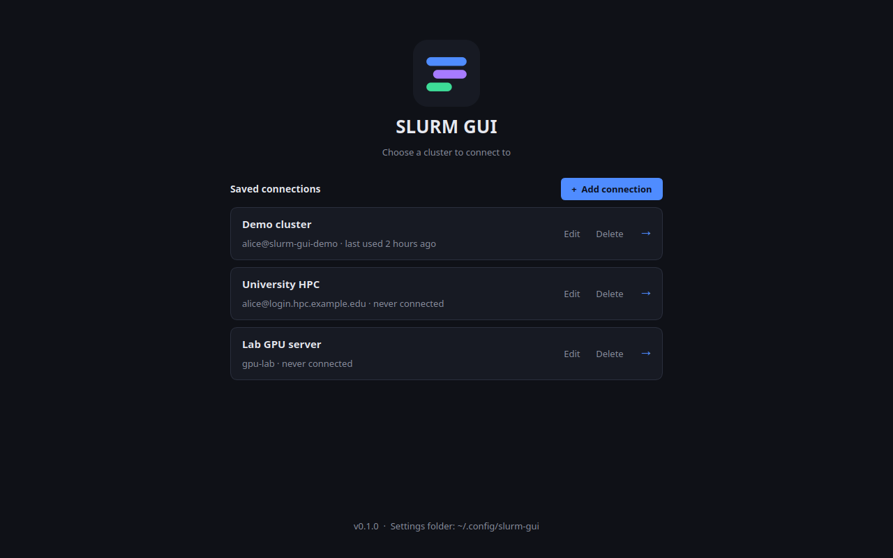
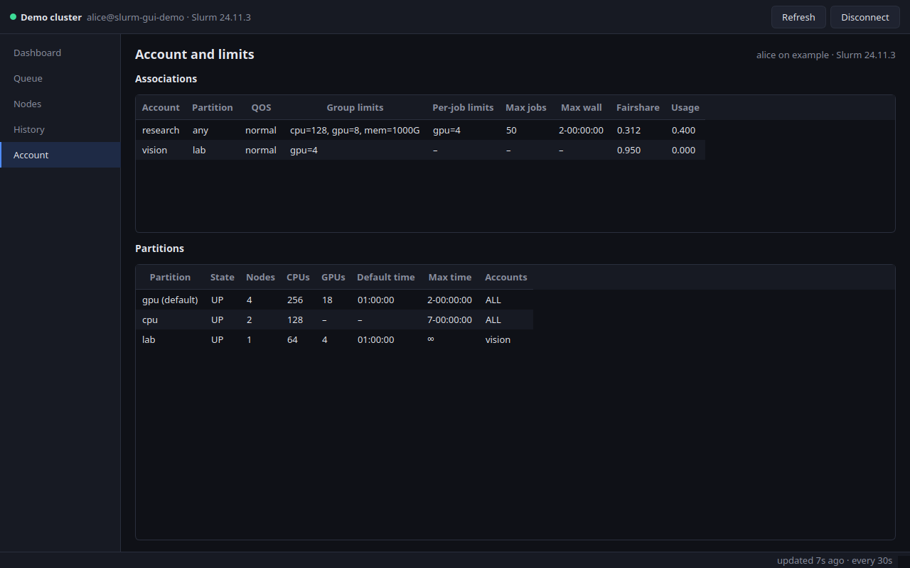

<p align="center">
  
</p>

<h1 align="center">SLURM GUI</h1>

<p align="center">
  A desktop app to monitor and control your jobs on <b>any</b> SLURM cluster.<br>
  It runs on your computer and talks to the cluster over SSH: nothing to install on the cluster.
</p>

<p align="center">
  <a href="https://github.com/GianniMoretti/slurm-gui/releases/latest">Download</a> ·
  <a href="#install">Install</a> ·
  <a href="#run-from-source-with-python">Run from source</a> ·
  <a href="#features">Features</a> ·
  <a href="LICENSE">MIT license</a>
</p>



> All screenshots show the built-in demo cluster (`slurm-gui --demo`); every name in them is made up.

## Features

- **Dashboard.** Your running and pending jobs, the GPUs you use against your account's limit,
  your fairshare (hover it for an explanation with your cluster's own numbers), free GPUs by type
  in the partitions you can use, and an activity feed: your jobs of the last 24 hours, then live
  changes as they happen.
- **Queue.** The live queue with filters (text, only your jobs, running or pending). Cancel, hold
  and release your jobs, one or many at a time. Hover a pending reason to read it in plain English
  (for example `AssocGrpGRES` → "Your account is at its GPU limit").
- **Nodes.** Every node as a tile: state, GPUs allocated, CPU use; filter by partition and GPU type.
  Hover a node for its details and the reason it is drained or down.
- **History.** Your finished jobs from accounting (24 hours, 7 or 30 days) with completed, failed
  and timed-out counts and GPU hours.
- **Account.** Your accounts with their limits and fairshare, and the partitions with their
  default and maximum run times.
- **Job details.** Double-click a job: its full record and a live tail of its output and error files.
- **Desktop notifications** when one of your jobs starts, completes or fails.
- **Works with any SLURM cluster.** It uses only the standard commands (`squeue`, `scontrol`,
  `sacct`, `sacctmgr`, `sshare`) through your normal SSH login, so no admin rights or server-side
  software are needed. See [what it runs on the cluster](#what-it-runs-on-the-cluster).

<table>
  <tr>
    <td></td>
    <td></td>
  </tr>
  <tr>
    <td align="center">Queue</td>
    <td align="center">Nodes</td>
  </tr>
  <tr>
    <td></td>
    <td></td>
  </tr>
  <tr>
    <td align="center">History</td>
    <td align="center">Job details with live output</td>
  </tr>
  <tr>
    <td></td>
    <td></td>
  </tr>
  <tr>
    <td align="center">Saved connections</td>
    <td align="center">Account and limits</td>
  </tr>
</table>

## Install

Download the file for your system from the
[latest release](https://github.com/GianniMoretti/slurm-gui/releases/latest).

| System | Download |
|---|---|
| Linux (x86_64) | `slurm-gui-<version>-linux-x86_64.AppImage`, or the `.tar.gz` |
| macOS (Apple Silicon: M1 and later) | `slurm-gui-<version>-macos-arm64.dmg` |
| macOS on Intel, Windows | no release: [run from source](#run-from-source-with-python) |

The releases are **not code-signed** (signing costs money every year), so your system may
warn you the first time. The steps below cover that.

### Linux

**AppImage** (a single file, nothing to install):

```bash
chmod +x slurm-gui-*-linux-x86_64.AppImage
./slurm-gui-*-linux-x86_64.AppImage
```

If it says that FUSE is missing, install it (`sudo apt install libfuse2` on Ubuntu 22.04,
`libfuse2t64` on 24.04 and later), or run it without FUSE:
`./slurm-gui-*.AppImage --appimage-extract-and-run`.

**tar.gz** (a folder you can put anywhere):

```bash
tar xzf slurm-gui-*-linux-x86_64.tar.gz
./slurm-gui-*/slurm-gui
```

### macOS (Apple Silicon)

1. Open the `.dmg` and drag **SLURM GUI** into **Applications**.
2. The first time, macOS blocks apps from unidentified developers. Either right-click the app in
   Applications → **Open** → **Open**, or go to **System Settings → Privacy & Security** and click
   **Open Anyway**. If macOS says the app "is damaged", that is the same block; remove it with:

   ```bash
   xattr -dr com.apple.quarantine "/Applications/SLURM GUI.app"
   ```

## Run from source with Python

This works on every system, including Windows and Intel Macs. You need **Python 3.11 or newer**.

```bash
git clone https://github.com/GianniMoretti/slurm-gui.git
cd slurm-gui
python3 -m venv .venv
source .venv/bin/activate          # Windows: .venv\Scripts\activate
pip install -e .
slurm-gui                          # or: python -m slurm_gui
```

To try it without a cluster, start the demo:

```bash
slurm-gui --demo
```

Next time, just activate the environment and run `slurm-gui`. To update: `git pull` and
`pip install -e .` again.

## Getting started

1. On the first screen, click **Add connection**.
2. Fill in the **Host**. It can be a host name (`login.cluster.example.org`) or, simpler, an alias
   from your `~/.ssh/config`: user, port, keys and `ProxyJump` are then taken from there, exactly
   like the `ssh` command. Leave the other fields empty unless you need them.
3. Click **Save and connect**. If the cluster asks for a password or a 2FA/OTP code, a field
   appears on the loading screen.
4. **Disconnect** (top right) brings you back to your saved connections.

Things to have ready:

- **SSH works from a terminal.** If `ssh <host>` logs you in, the app will too. Keys and the
  SSH agent are supported.
- **The host is known.** The cluster's host key must be in your `known_hosts`. If it is the first
  time you connect, run `ssh <host>` once in a terminal and accept the key.
- **VPN.** Many clusters are only reachable from the institution's network. A connection that
  times out usually means the VPN is off.

### Where your settings are stored

Your saved connections and settings are in one folder (shown at the bottom of the first screen;
click it to open the folder):

| System | Folder |
|---|---|
| Linux | `~/.config/slurm-gui` |
| macOS | `~/Library/Application Support/slurm-gui` |
| Windows | `%APPDATA%\slurm-gui` |

It contains `profiles.json` (connections) and `settings.ini` (window size, last page). The app never
stores passwords.

## What it runs on the cluster

Read-only queries, every 30 seconds by default (you can only make it slower, never faster, to
spare the cluster's scheduler):

| Command | When |
|---|---|
| `squeue`, `scontrol show node` | every refresh |
| `scontrol show config`, `scontrol show partition`, `sacctmgr show assoc`, `sshare` | when connecting |
| `sacct` | History page, and once when connecting (activity feed) |
| `scontrol show job`, `tail` | when you open a job (its log files) |

Commands that change something run only when you click: `scancel` (Cancel),
`scontrol hold` / `scontrol release` (Hold / Release), always on your own jobs only.

## How it works

- **One SSH connection.** A single persistent [asyncssh](https://asyncssh.readthedocs.io)
  connection per cluster, on a background thread, so the window never freezes. It reads
  `~/.ssh/config` and works the same on Linux, macOS and Windows.
- **Plain-text output, not `--json`.** `squeue --json` is about 100 times larger than a delimited
  text format and is missing from older SLURM versions. Every query uses a `|`-separated format
  with free text (the job name) last, or `scontrol show … -o` key=value lines.
- **Login banners are ignored.** Each command prints a marker before its output, so welcome
  messages and shell-profile noise never reach the parsers.
- **Cluster-specific facts are read, never assumed.** Limits, partitions, default times and
  priority settings come from the cluster itself.

```
src/slurm_gui/
  core/       SSH session, asyncio <-> Qt bridge
  slurm/      command lines, parsers, data classes, pending-reason texts, async client
  services/   ClusterState: connection, polling, job events, actions
  config/     settings folder, saved connections
  ui/         theme, logo, screens (welcome -> loading -> workspace), pages, widgets
  demo/       the demo cluster (also the parsers' test data)
  assets/     logo
packaging/    standalone builds (PyInstaller)
scripts/      screenshots, capturing test data from a real cluster
tests/
```

## Development

```bash
pip install -e '.[dev]'
pytest                                          # parser and model tests
QT_QPA_PLATFORM=offscreen python scripts/screenshots.py   # regenerate docs/screenshots from the demo
```

The parsers are tested against the demo cluster in `src/slurm_gui/demo/data/`, written to cover
the tricky cases (job names containing the separator, array jobs, drained nodes, hidden and
account-restricted partitions, unlimited time limits). To also test against a real cluster,
capture its output locally. The folder is gitignored, so a real site's data never ends up in the
repository:

```bash
python scripts/capture_fixtures.py <ssh-host> <name>      # read-only commands only
python scripts/anonymize_fixtures.py tests/fixtures/<name> --keep <your-username>
pytest
```

### Building a release

Each system builds its own package (PyInstaller cannot cross-compile):

```bash
pip install -e '.[build]'
python packaging/build.py                       # output in dist/release/
```

On Linux this makes the `.tar.gz`, plus the `.AppImage` when
[appimagetool](https://github.com/AppImage/appimagetool) is available
(`--appimagetool <path>`). On macOS it makes the `.dmg`.

To publish a release, set the version in `pyproject.toml`, commit, then tag and push:

```bash
git tag v0.1.0
git push origin v0.1.0
```

The [Release workflow](.github/workflows/release.yml) then runs the tests, builds Linux and
macOS (Apple Silicon) on GitHub's machines, starts each build once in demo mode as a smoke test,
and publishes the GitHub Release with the files attached. It can also be started by hand from the
Actions tab to build without publishing.

## Roadmap

- GPU use of running jobs (`nvidia-smi` through `srun --overlap`)
- Remote file browser for logs and results
- An integrated SSH terminal

## License

[MIT](LICENSE)
